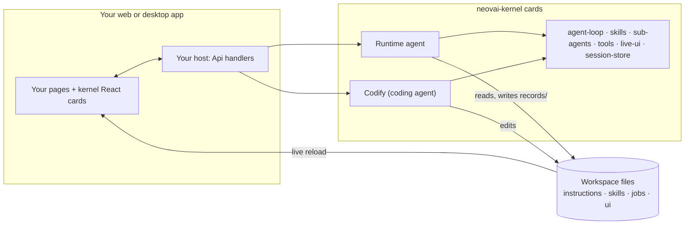

# neovai-kernel

*A small set of pluggable cards that give an ordinary web or desktop app two portable agents, one that does the app's work and one that changes the app, without handing the app over to a framework.*

TypeScript source package, no build step. Needs Node 22.5+ (`node:sqlite`).

## Why I built this

I kept building the same agent plumbing into every app. A model loop, file and shell tools, a chat that shows what the agent is doing, skills, sub-agents, a place to save sessions. Each app got its own copy, and each copy drifted.

The agent frameworks I looked at solve this by becoming the app. They own the process, the UI and the loop, and you build inside them. That works for a demo. It gets in the way when you already have an Electron window, a web server, your own routing and your own design system.

So I went the other way. The kernel is a **pluggable agent harness**: small cards that an app imports where it needs them. Neovai stands for neo-evolution-ai, meaning apps that improve their own instructions, logic and UI from feedback.

### Plug it in, don't move in

Each card is a plain TypeScript library with one import point. The app keeps its Electron main process or web server, its IPC or HTTP layer and its React pages. It calls the cards where it needs them. `compose([...])` only checks that the chosen set is complete. A chat assistant might take two cards; a self-changing app takes all of them.

### Two agents, one harness

Here's the part I care about most. Every app built on the kernel gets the same two agents, made from the same parts (the `agent-loop` session, tools, `skills`, `sub-agents`):

| | **Runtime agent** (`runtime-agent`) | **Coding agent, "Codify"** (app-built from `agent-loop`) |
|---|---|---|
| Purpose | Does the app's work: runs jobs, answers questions, fills screens with data | Changes the app: its UI, logic, skills, jobs and instructions |
| Reads | instructions, every skill, the job, fresh from disk on each run | the whole workspace, plus the list of skills and jobs |
| Writes | only `records/` | the workspace (except files the user owns) |
| Shown with | run activity under a screen's run button | the full chat (`chat-view`) |

Both agents read their behavior from files in a **workspace** (`instructions/`, `skills/`, `jobs/`, `ui/`). That is what makes them portable. They move from app to app unchanged; the app supplies only its prompt, its workspace and its screens.

### The app changes while it runs

Codify edits a skill, and the next run uses it. It edits a JSON screen or writes a `.tsx` panel, and `live-ui` compiles and shows it at once. If the new version breaks, the last good one stays on screen. There's no rebuild and no release. When users accept or decline a recommendation, that feedback lands in the workspace too, and Codify can turn it into better skills. That loop is the "evolution" in the name.

### Same harness on desktop and web

Headless cards run in any Node process. Cards with UI ship their React parts under separate subpaths, so the main process never loads React. An app defines one `Api` contract and implements it twice: an Electron preload and a fetch-plus-event-stream client, over one shared core. The same window code and the same agents then serve a desktop install, or one session per signed-in web user.

### One chat everywhere

The `chat-view` card gives every app the same chat. Each turn starts as a one-line summary that opens to plain-language steps, and each step opens to its raw detail. There's a folding thoughts block, sub-agent trees, attachments, session history with rename, clickable links and a turn rail. Users learn it once.

### It grows by cards, not forks

When a feature should be shared, it becomes a new kernel card. The kernel is tagged, and each app pins a tag in its `kernel.json`. Private or company-specific cards live in a separate repo that extends the kernel's registry, so this repo stays generic.

The limit is worth saying plainly. The kernel doesn't give you an app. You still write the host (the handlers behind the `Api`), the coding agent's prompt and the workspace. What you skip is rebuilding the harness each time.

Here's the whole thing on one page:



For the full design and step-by-step wiring, read [docs/ARCHITECTURE.md](docs/ARCHITECTURE.md).

## Cards

| Card | What it gives you |
|---|---|
| `agent-loop` | Model/tool loop, `Session`, tool and event types. A prompt sent while a run is in progress is queued and joins the conversation before the next model call (`send(prompt, attachments, qid)`, `queued`, `unqueue(qid)`). Since 0.21.0, a model call that fails for a reason worth another try (a dropped connection such as Node's `terminated` or `fetch failed`, a timeout, 429, 5xx, a provider "overloaded" error) is tried up to four times, 2, 5 and 10 seconds apart, also when part of the reply had already streamed; a `retry` event lets the chat drop the partial reply and show "Trying again…", and the final error names the real cause (`terminated (other side closed, UND_ERR_SOCKET)`). See [Model calls that fail](docs/ARCHITECTURE.md#75-model-calls-that-fail). Every tool takes an extra plain-language `intent` (added to its schema, removed before it runs) so chats can say what a step does; `PLAIN_LANGUAGE_RULES` tells an agent to talk to a non-technical user |
| `model-providers` | OpenAI-compatible, Azure and Vertex adapters behind one router |
| `file-tools` | read / write / edit / glob / grep, locked to one root folder |
| `shell` | Shell command tools, sync and background |
| `web-fetch` | Read-only web page fetch as markdown |
| `approval` | Permission gate (ask, allow for session, auto-approve) |
| `session-store` | SQLite store for chats, messages and usage |
| `settings` | Settings file with sealed API keys |
| `skills` | App-embedded skills: `<dir>/<name>/SKILL.md` files, listed in the prompt and loaded on demand with the `skill` tool, or inlined in full for a runtime agent (`skillsInstructions`). Since 0.14.0, several folders at once (0.14.1 reads YAML `>` and `|` block descriptions): `loadSkillSources([{dir, label, editable}])` merges them in order (the app's own copy of a name wins), shared folders (such as `.github/skills`, `~/.copilot/skills`) are marked read-only in the prompt, `makeSkillTool({sources})` loads from any of them, and `writeSkill` saves an editable one. `SkillList` (from `neovai-kernel/cards/skills/react`, styles from `.../styles.css`) lists skills grouped by folder with a read-only lock |
| `chat-view` | The chat experience: messages, a folding thoughts block, collapsed tool-call rows, and the standard `Composer` that attaches images and text files by a paperclip button, paste or drag and drop, and (with `onPublish`) a publish button next to it (images downscaled in the window, shown as thumbnails in the conversation; send them with `session.send(prompt, attachments)`). Since 0.18.0, an attachment can carry its `path` on disk, a PDF goes as the file itself to Claude and as text to other models, and a scanned PDF goes as one image per page; the app supplies the PDF reading through `Composer prepareAttachment={fn}` and `pdfAttachment` (see the [attachments guide](docs/ATTACHMENTS.md)). Tool rows have three levels: a one-line summary ("<step> and N other steps"), which opens to its steps in plain words (the call's `intent`), each of which opens to a detail panel with what it was given (`$ command` for shell calls, the intent removed) and its output; `MessageList technical` labels steps with raw tool names. Since 0.14.0, `SessionList` is the session history column: new, select, rename (pencil or double-click; Enter saves, Escape cancels) and delete. Since 0.15.0, links and a turn rail: `MessageList links={rules}` makes bare http(s) URLs in user messages clickable and applies the app's `LinkRule`s (`{pattern, href, title?}`, for example ticket keys to its tracker) to user text and, as markdown links, to assistant text (code and existing links untouched); `Linked` draws any text that way; `TurnRail scrollRef deps` puts a tick per user turn on the right edge of the scrolling chat (hover: "Turn N · prompt", click: jump, the turn in view highlighted; place it in a positioned parent of the scroll element). The kernel ships no app-specific patterns. Since 0.20.0, a prompt queue: `Composer queue={prompts} onUnqueue={fn}` keeps Send available while the agent works (as **Queue**, next to Stop) and draws waiting prompts as chips (Next, +1, …; × takes one back); `applyChatEvent` moves a prompt into the thread when the model receives it and hands back the ones a stop cleared (see the [prompt queue guide](docs/PROMPT-QUEUE.md)). View model in `index.ts`; React components from `neovai-kernel/cards/chat-view/react`; styles from `neovai-kernel/cards/chat-view/styles.css` |
| `runtime-agent` | Runs an app's own functions (jobs, `jobs/<name>.md`) headlessly with every skill appended to the instruction, read fresh each run; writes only under `records/`; `save_data` stores JSON for screens; `run(job, input)` passes options picked on a screen and keeps them with the report; `run(job, input, attachments)` (0.19.0) sends files with the run the way a chat sends them (images, PDFs, scanned pages, text) and the report keeps only their names and paths; follows `PLAIN_LANGUAGE_RULES`; `goalsTitle` names the user's settings file in its instruction; `subAgents: true` (0.11.0) lets a run hand independent parts of a job (e.g. one per stock) to parallel helpers that share its tools and write limits; `sharedSkills` (0.14.0) lists read-only shared skill folders by name, loaded on demand with the `skill` tool |
| `live-ui` | Screens that change while the app runs: JSON descriptions (`ui/screens/<name>.json`) drawn with built-in blocks, and `.tsx` code panels compiled at runtime with the last good version kept; `check_ui` tool for the coding agent; Accept/Decline on recommendation blocks (`decide: true`, saved by `decide()` to `decisions.json`); run blocks show elapsed time, the current step and live activity. A screen may list the `skills` it is built on; a `skill` block shows a skill's text; with `host.codify` every screen gets a bar to change it or open its skills. Panels are interactive through `@neovai/panel` (`useApp`: data, `run(job, input)`, stop, progress, last report, `decide`, `codify`; `usePanelState`; `Blocks`, `RunButton`, `Markdown`); apps add allowed libraries with `registerHostModules(extra)` and `externals`. `run` blocks take `input`. Panels read the user's preferences (`prefs`) and save them (`savePrefs`) when the host passes `prefs`/`savePrefs`. Since 0.9.0: a `chart` block and `<Chart>` component (trading-style SVG candlesticks, line, area, bar, volume pane, last-price tag, hover O/H/L/C); live data in panels through `host.fetch` (main-process `panelFetch`: GET, http/https, size and time caps) as `useFetch(url, refreshSecs)` and `useApp().fetchJson/fetchText`; panels may import plain `.css` files (injected as style tags) and split into many relative files. Since 0.15.0, `host.links` (`LinkRule[]`): URLs and app patterns in table, list and metric cells and in markdown blocks become links, table cells show their full text on hover, and panels get `Linked` from `@neovai/panel`. `linkSegments`/`linkMarkdown` are exported from `agent-loop`. React side from `neovai-kernel/cards/live-ui/react`; styles from `.../styles.css` |
| `sub-agents` | Since 0.11.0. `SubAgents` gives an agent `task`, `read_agent` and `list_agents`: a sub-agent starts with fresh context (only the prompt it is given) and hands back only its final answer. Several `task` calls in one reply run **in parallel**, bounded by the session's shared semaphore (held only while a model streams, so nested agents never deadlock). `mode: "background"` returns an id at once; when the sub-agent ends, the parent gets a `<system_notification>` and an idle main agent wakes up (`Session.notify`). Named roles (`agents: [{name, description, system, tools?}]`), a depth limit (`maxDepth`, default 2), and Stop cancels the whole tree (`attach(session)`). `agent_start` carries the `callId` of its `task` step, so `chat-view` draws each sub-agent's own steps and answer under that step, at any depth |
| `git-publish` | Since 0.12.0. One-click publish: `publish({url | repo, mirror?, onEvent})`. With `url` (since 0.13.0) it downloads the remote repository into a temporary folder, updates and pushes it, then deletes the folder, so no local working copy is needed; with `repo` it uses a local one. It copies the folder the app edits into the repository (`mirror: {from, to, exclude}`, `to` relative to the repository: new and changed files copied, removed ones deleted, globs such as `records/**` left out), then commits and pushes. The commit message names the changed folders by default; with `describe: commitMessageWriter({adapter, model, context})` (since 0.17.0) a model writes it from the staged diff and the requests that led to it, with a subject line, a "Why:" reason and a "What changed:" list. Every step is emitted as a plain-language `shell` step through `onEvent`, so a `chat-view` list shows the progress live, and the result's `messages` can be saved to the chat. A failed push keeps the commit and shows git's reason. `Composer onPublish` draws the publish button next to attach |
| `context-memory` | Since 0.16.0. Just-in-time recall and compaction for long chats. Every turn is indexed in the store's SQLite file (full-text search, no embeddings). A `recall` tool lets the model search earlier turns of this chat, chats of the same folder, all chats, or one chat by name; `RECALL_PROMPT` tells it when to. With hints on, `send` attaches up to four one-line pointers to matching earlier turns after the prompt, so the cached prefix is unchanged, and only on a strong match. `compact` replaces older turns with a summary (keep, summarize or drop per turn; `analyze` groups turns for user selection; `send` can do it automatically past a token limit); removed turns stay searchable under their original turn number |

Each card lives in `cards/<name>/` with `index.ts` (the only import point for headless code), `card.json` and tests. Cards with UI also ship `react.tsx` and `styles.css`, imported by their own subpaths so `index.ts` stays loadable in Node.

## Use in an app

The snippets below are the short version. The [architecture guide](docs/ARCHITECTURE.md) walks through a full app.

```json
{ "dependencies": { "neovai-kernel": "file:../neovai-kernel" } }
```

```ts
import { compose } from 'neovai-kernel/compose'
import { Session } from 'neovai-kernel/cards/agent-loop'
import { makeFileTools } from 'neovai-kernel/cards/file-tools'

compose(['agent-loop', 'file-tools']) // throws on an unknown card or a missing dependency
```

Sub-agents (parallel or background helpers with fresh context):

```ts
import { SubAgents } from 'neovai-kernel/cards/sub-agents'

const subs = new SubAgents({ adapter, hooks, gate, cwd, model: () => settings.model, tools: () => tools })
const session = new Session({ adapter, hooks, gate, model, cwd, system, tools: () => [...tools, ...subs.tools()] })
subs.attach(session) // shared concurrency limit, background notices, Stop cancels every sub-agent
```

Publish button (commit and push the app's edits, progress in the chat):

```tsx
import { publish } from 'neovai-kernel/cards/git-publish'

// main process
const r = await publish({ url: 'git@github.com:me/app.git', mirror: { from: workspace, to: 'workspace', exclude: ['records/**'] }, onEvent: (e) => send(chatId, e) })
store.saveMessages(chatId, [...history, ...r.messages])

// window
<Composer onPublish={() => api.publish(chatId)} publishing={busy} ... />
```

Session history and skills (the app frame):

```tsx
import { SessionList } from 'neovai-kernel/cards/chat-view/react'
import { SkillList } from 'neovai-kernel/cards/skills/react'

<SessionList sessions={chats} active={id} onSelect={open} onRename={(id, t) => api.renameChat(id, t)} onDelete={remove} onNew={newChat} />
<SkillList skills={skills} active={name} onOpen={show} sourceTitles={{ Workspace: 'This app' }} />

// main process: the app's skills first, then shared read-only folders
const sources = [{ dir: 'workspace/skills', label: 'Workspace', editable: true }, { dir: '~/.copilot/skills', label: '~/.copilot/skills', editable: false }]
createRuntime({ ..., sharedSkills: () => sources.slice(1) })
```

Recall and compaction (long chats): see the [context-memory technical guide](docs/CONTEXT-MEMORY.md) for turn storage, manual/automatic compaction, Auto Pin versus agent-triggered recall, and backend request examples.

```ts
import { ContextMemory, RECALL_PROMPT } from 'neovai-kernel/cards/context-memory'

const mem = new ContextMemory({ store, session: (id) => sessions.get(id), hints: () => settings.recallHints })
const session = new Session({ ..., system: system + '\n\n' + RECALL_PROMPT, tools: [...tools, mem.tool(chatId)] })

await mem.send(chatId, session, prompt, { auto: { mode: 'auto', threshold: 120_000, hardLimit: 160_000, idleMinutes: 5, keepRecent: 6, minGain: 20_000 }, onCompact: (r) => notify(chatId, r), onError: showMemoryError })
await mem.compact(chatId, session, plan) // user-selected keep/summarize indexes; mem.analyze(session) supplies topic groups, not a plan
void mem.backfill()                      // once at startup: index chats saved before the card was added
mem.index.forget(chatId)                 // when a chat is deleted
```

Prompt queue (keep typing while the agent works): pass the composer a `queue`. The [prompt queue guide](docs/PROMPT-QUEUE.md) covers when a queued prompt reaches the model, stop and failure, and the full wiring.

```tsx
const r = applyChatEvent({ items, queue }, event)   // in place of applyEvent; r.restored = prompts a stop handed back
<Composer ... running={busy} queue={queue} onUnqueue={(q) => api.unqueue(chatId, q.qid)} />
```

Attachments (PDFs, Office files, file paths): images and text files work with no code. For the rest, give the composer one function. The [attachments guide](docs/ATTACHMENTS.md) has the full example, the limits and what each model receives.

```tsx
import { pdfAttachment } from 'neovai-kernel/cards/chat-view'
import { Composer, type PrepareAttachment } from 'neovai-kernel/cards/chat-view/react'

const prepareAttachment: PrepareAttachment = async (file) => {
  if (!/\.pdf$/i.test(file.name)) return                 // other files: the built-in reader
  const { data, pageTexts, path } = await api.readPdf(file) // the app's PDF library: base64, text per page, path on disk
  return pdfAttachment({ name: file.name, data, size: file.size, pageTexts, path })
    ?? { kind: 'pages', name: file.name, path, ...(await api.renderPdfPages(file)) } // null = scanned: {pages, total}
}

<Composer prepareAttachment={prepareAttachment} onSend={(prompt, attachments) => api.send(chatId, prompt, attachments)} ... />
```

Apps pin a tagged release of this repo.

## Use as a template

Neovai Investor (`careychou/neovai-investor`) is the reference app built on these cards. To start a new app, I copy it, rename it, keep only the cards I need, and replace its `workspace/` (instructions, skills, jobs, screens, panels). When a feature should be shared by every app, it goes here as a card. Then I tag the kernel and pin the tag in the app's `kernel.json`.

## Checks

```bash
npm test                 # card unit tests
npm run test:regression  # run by hand before each tag
npm run typecheck
```
