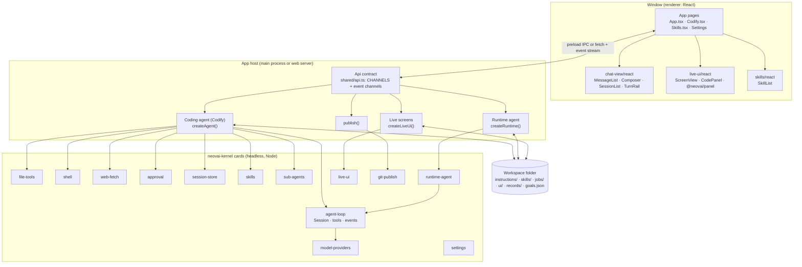
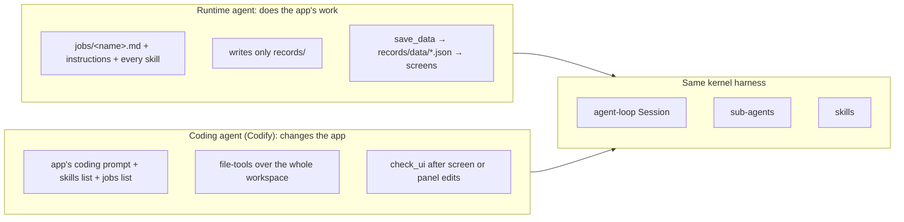
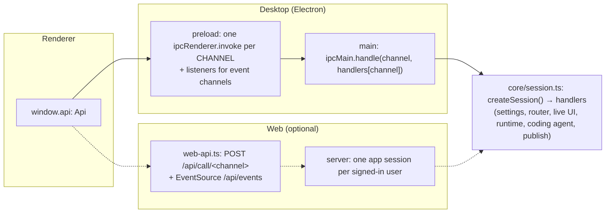
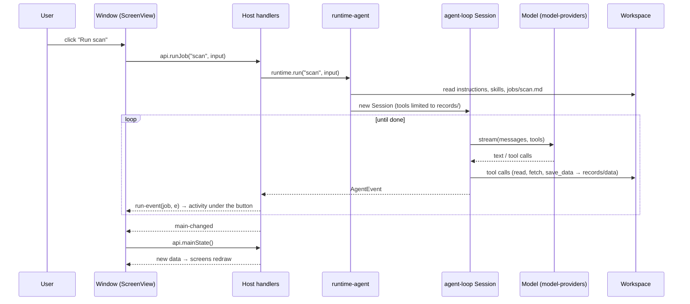
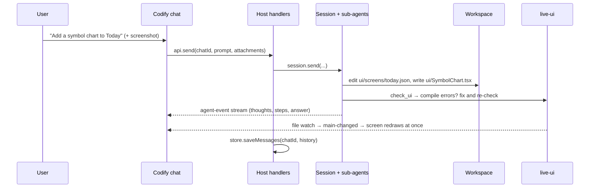

# Architecture: plugging the kernel's agent harness into an app

This guide is for teams that want to build an agentic desktop app (or a web app) on the kernel's cards. It explains the
parts, how they fit, and the exact wiring an app writes. Two apps already use this pattern:

- **Neovai Investor** (`careychou/neovai-investor`), the public reference app. It recommends stocks with a runtime agent
  and lets the user change the app with a coding agent.
- **A use-case assessment app** (internal, not public). It uses the same wiring, adds a desktop **and** web front end over
  one shared core, and adds one card of its own from a **private card repo**. That shows how to extend the kernel
  without forking it.

## 1. The big picture

An app is three layers. The kernel supplies the bottom layer and the chat and screen components. The app writes a thin
host in the middle, and keeps all of its behavior as files in a **workspace** that agents read and change while it runs.



Key ideas:

- **Cards are libraries, not a framework.** The app imports each card from `neovai-kernel/cards/<name>` and calls it.
  Nothing in the kernel owns the window, the IPC or the process. `compose([...])` only checks that the app's card list is
  complete.
- **Headless and UI are split.** `cards/<name>/index.ts` runs in Node (main process, tests, a web server). Cards with UI
  also ship `react.tsx` and `styles.css` under their own subpaths, so the main process never loads React.
- **Behavior lives in the workspace, not in code.** Instructions, skills, jobs and screens are files. Agents read them
  fresh on every run, so a change needs no rebuild.
- **One harness, two agents.** Both agents are a kernel `Session` with tools. What differs is the prompt and the
  tools they get (section 3).

## 2. The cards

| Card | Runs in | Needs | Role in the harness |
|---|---|---|---|
| `agent-loop` | Node | none | `Session`: the model/tool loop, queued prompts, stop, `notify` wake-ups, the `AgentEvent` stream, `ToolDef`, `PLAIN_LANGUAGE_RULES`, link rules |
| `model-providers` | Node | agent-loop | `ProviderRouter`: OpenAI-compatible, Azure and Vertex behind one `stream()` |
| `settings` | Node | agent-loop, model-providers | Settings file with API keys sealed by a `SecretBox` the app supplies (OS keychain on desktop) |
| `file-tools` | Node | agent-loop | read/write/edit/glob/grep locked to one root, with read-only files |
| `shell` | Node | agent-loop | Shell tools, sync and background (`ShellManager`) |
| `web-fetch` | Node | agent-loop | Read-only web page fetch |
| `approval` | Node | agent-loop | `PermissionGate` (ask, allow for session, auto-approve) |
| `session-store` | Node | agent-loop | SQLite chats, messages and token usage (`Store`) |
| `skills` | Node + React | agent-loop | `SKILL.md` folders: prompt listing, `skill` tool, several sources (editable app skills, read-only shared ones), `SkillList` |
| `sub-agents` | Node | agent-loop | `task` / `read_agent` / `list_agents`: parallel and background helpers with fresh context |
| `runtime-agent` | Node | agent-loop, file-tools, skills, approval, sub-agents | Runs `jobs/<name>.md` headless with instructions and skills inlined, writes only under `records/`, `save_data` for screens |
| `live-ui` | Node + React | agent-loop | JSON screens and runtime-compiled `.tsx` panels, `check_ui` tool, `ScreenView`, `@neovai/panel` |
| `chat-view` | React (+ Node view model) | agent-loop | Event-to-item view model (`applyEvent`, `fromMessages`) and the chat components |
| `git-publish` | Node | agent-loop | Copies the workspace into a repository (a temporary clone of a remote one), commits, pushes, streams each step as chat events |

Pick only what you need. A chat-only assistant needs `agent-loop`, `model-providers`, `settings`, `session-store`,
`chat-view` and some tools. Add `runtime-agent` and `live-ui` for an app with screens and jobs.

## 3. Two agents on one harness



| | Runtime agent | Coding agent |
|---|---|---|
| Built with | `createRuntime({...})` from `runtime-agent` | the app's own `createAgent()` around `Session` |
| Started by | a run button on a screen, a panel's `run(job, input)`, a schedule | the user typing in the Codify chat |
| Prompt | `RUNTIME_BASE` + `instructions/system.md` + every skill in full + the job | the app's coding prompt + skills listed (loaded on demand) + jobs + preferences |
| Can write | only `records/` (plus `save_data`) | the whole workspace, except read-only files such as `goals.json` |
| Output | a report and JSON data the screens draw | edits to screens, panels, skills, jobs, instructions and code |
| UI | run activity under the run button (`MessageList` fed by run events) | full chat (`MessageList`, `Composer`, `SessionList`, `TurnRail`) |

Both stream the same `AgentEvent`s, so the same `chat-view` components draw both.

## 4. Process layout and the Api contract

The app defines one TypeScript interface, `Api`, in `shell/shared/api.ts`. It lists every call the window may make and
the event channels the host pushes. Three thin adapters implement it:



- **Desktop only** (Investor): the handlers live in `shell/main/index.ts`.
- **Desktop and web** (the assessment app): the handlers move into `shell/core/session.ts`,
  `createSession({workspace, dataDir, box, emit, ...})`. Electron calls it once and sends events with
  `win.webContents.send`. The web server calls it once per user, each with their own workspace, and sends events over
  that user's event stream. The renderer is the same build; it only swaps `window.api`.

Event channels used by both apps:

| Channel | Payload | Drawn by |
|---|---|---|
| `agent-event` | `(chatId, AgentEvent)` | Codify chat: `applyEvent(items, e)` → `MessageList` |
| `run-event` | `(job, AgentEvent)` | run activity under a screen's run button |
| `main-changed` | none | reload `mainState()`: screens, data, running jobs, reports |

## 5. The workspace contract

```
workspace/
  instructions/system.md     the runtime agent's standing instruction
  skills/<name>/SKILL.md     how to do the work (description:, order: in front matter)
  jobs/<name>.md             what a run does (title:, description:, then the prompt)
  ui/screens/<name>.json     screens: {title, order, skills, blocks}
  ui/*.tsx, ui/*.css         code panels (compiled at runtime; last good version kept)
  records/                   runtime output only (reports, records/data/*.json)
  goals.json                 user preferences: read-only for both agents
```

The installed app is read-only, so on first start the host copies the bundled `workspace/` into the user's data folder
and works on that copy (`seedWorkspace`). `git-publish` sends the shared folders back to the app's repository, leaving
out `records/**`, `goals.json` and caches.

## 6. Wiring a new app, step by step

The snippets are trimmed from Neovai Investor. Read its `shell/` folder for the complete versions.

### 6.1 Depend on a tagged kernel

```json
// package.json
{ "dependencies": { "neovai-kernel": "file:../neovai-kernel" } }
// kernel.json
{ "tag": "v0.15.0" }
```

`npm run check:kernel` (copy `scripts/check-kernel.mjs`) fails unless the sibling kernel checkout is clean and exactly at
that tag. Build and release only when it passes.

### 6.2 Declare the cards

```ts
// shell/main/agent.ts
import { compose } from 'neovai-kernel/compose'
export const CARDS = ['agent-loop', 'model-providers', 'file-tools', 'shell', 'web-fetch', 'approval', 'session-store',
  'settings', 'skills', 'chat-view', 'runtime-agent', 'live-ui', 'sub-agents', 'git-publish']
compose(CARDS) // throws on an unknown card or a missing dependency
```

### 6.3 Settings and the model router

```ts
const box: SecretBox = { available: () => safeStorage.isEncryptionAvailable(),
  seal: (v) => safeStorage.encryptString(v).toString('base64'),
  open: (v) => safeStorage.decryptString(Buffer.from(v, 'base64')) }
const store = createSettings<AppSettings>({ dir: dataDir, box, defaults: APP_DEFAULTS })
let router = new ProviderRouter(store.load().providers)
// Agents call through this adapter, so saving Settings (a new router) applies to the next prompt.
const adapter: ModelAdapter = { stream: (req, signal) => router.stream(req, signal) }
```

### 6.4 Live screens and the runtime agent

```ts
const ui = createLiveUi({ workspace, fallback: FALLBACK, onChange: changed, externals: [...DEFAULT_EXTERNALS, ...PANEL_LIBRARIES] })
ui.watch()
const runtime = createRuntime({
  workspace, adapter,
  settings: () => ({ model: runtimeModel, reasoning, maxTurns, maxOutputTokens, maxConcurrency }),
  readOnly: ['goals.json', 'records/data/decisions.json'],
  goalsTitle: 'Preferences (set by the user on the Preferences screen)',
  tools: [webFetch], subAgents: true, sharedSkills,
  onEvent: (_runId, job, e) => send('run-event', job, e)
})
```

### 6.5 The coding agent

The app owns this file because the prompt is app-specific. The harness part is always the same:

```ts
const store = new Store(dataDir)                       // session-store
const shells = new ShellManager()
const skillSources = () => [{ dir: `${workspace}/skills`, label: 'Workspace', editable: true }, ...sharedSkills()]
const tools = [...makeFileTools({ root: workspace, readOnly: READ_ONLY }), ...shellTools, webFetch,
  makeSkillTool({ sources: skillSources }), makeCheckUiTool(ui)]

function sessionFor(chatId: string): Session {
  const hooks: Hooks = { onEvent: (e) => { saveUsage(e); send('agent-event', chatId, e) },
    requestPermission: async () => 'allow', askUser: async () => '' }
  const gate = new PermissionGate(hooks, true)
  const subs = new SubAgents({ adapter, hooks, gate, cwd: workspace, tools, model: () => settings.defaultModel, system: () => BASE_PROMPT })
  const session = new Session({ adapter, hooks, gate, model, cwd: workspace, system: systemPrompt,
    tools: () => [...tools, ...subs.tools()], services: { shells }, history: store.loadMessages(chatId) })
  subs.attach(session)   // shared concurrency, background notices, Stop cancels every helper
  return session
}
// systemPrompt() = BASE_PROMPT + PLAIN_LANGUAGE_RULES + instructions + skillsPrompt(loadSkillSources(...)) + jobs + preferences
```

After each `session.send(prompt, attachments)`, save `session.history` with `store.saveMessages(chatId, ...)`. Also save
on the main agent's `agent_end` event, because a background helper can wake the chat after `send` returned.

### 6.6 Handlers, IPC and preload

```ts
// main
const handlers = { listChats, newChat, openChat, renameChat, deleteChat, send, stop, mainState, runJob, stopJob,
  loadPanel: (f) => ui.panel(f), decide, listSkills, readSkill, saveSkill, panelFetch, publish, ... }
for (const c of CHANNELS) ipcMain.handle(c, (_e, ...args) => handlers[c](...args))

// preload
for (const c of CHANNELS) api[c] = (...args) => ipcRenderer.invoke(c, ...args)
api.onEvent = listen('agent-event'); api.onRunEvent = listen('run-event'); api.onMainChanged = listen('main-changed')
contextBridge.exposeInMainWorld('api', api)
```

Route `http(s)` links out of the window (`setWindowOpenHandler` and `will-navigate` → `shell.openExternal`), because
chat and screen links are real anchors.

### 6.7 The window

```tsx
// main.tsx: kernel styles and the libraries panels may import
import 'neovai-kernel/cards/chat-view/styles.css'
import 'neovai-kernel/cards/live-ui/styles.css'
import 'neovai-kernel/cards/skills/styles.css'
registerHostModules({ 'react-dom': ReactDom, recharts, 'lucide-react': lucide, 'date-fns': dateFns })

// Codify.tsx: the chat
useEffect(() => window.api.onEvent((chatId, e) => setItems((s) => ({ ...s, [chatId]: applyEvent(s[chatId] ?? [], e) }))), [])
<SessionList sessions={chats} active={id} onSelect={open} onRename={rename} onDelete={remove} onNew={newChat} />
<div style={{ position: 'relative' }}>
  <div className="messages" ref={scroller}><MessageList items={items} Markdown={Markdown} links={LINKS} /></div>
  <TurnRail scrollRef={scroller} deps={items} />
</div>
<Composer value={text} onChange={setText} onSend={(text, atts) => api.send(id, text, atts)} running={busy}
  onStop={() => api.stop(id)} onPublish={() => api.publish(id)} publishing={publishing} />

// App.tsx: the screens
const host: ScreenHost = { data, loadPanel: api.loadPanel, runJob: api.runJob, stopJob: api.stopJob, running, reports,
  renderActivity: (job) => <MessageList items={runs[job] ?? []} Markdown={Markdown} links={LINKS} />,
  decide: api.decide, prefs, savePrefs, Markdown, links: LINKS, fetch: api.panelFetch, codify }
<ScreenView screen={screen} name={name} errors={errors} host={host} tick={tick} />
```

`LINKS` is the app's own `LinkRule[]` (Investor links `$AAPL` to a quote page; the assessment app links ticket keys to
its tracker). Bare URLs are links without any rule.

## 7. A turn, end to end

Runtime agent, from a run button to updated screens:



Coding agent, from a chat request to a changed screen:



## 8. Extending without forking: a private card repo

When an app needs cards that must stay private (company connectors, internal skill installers), put them in a separate
repo that depends on the kernel and adds cards in the same format. The assessment app does exactly this:

```
private-harness/
  cards/<card>/index.ts, api.ts, react.tsx, styles.css, card.json   same layout as kernel cards
  cards/registry.ts   REGISTRY = [...kernel REGISTRY, ...HARNESS]
  compose.ts          the same compose() check over both registries
  kernel.json         the kernel tag this harness is tested with
```

```ts
// cards/registry.ts in the private repo
import { REGISTRY as KERNEL, type CardInfo } from 'neovai-kernel/compose'
import myCard from './my-card/card.json' with { type: 'json' }
export const HARNESS: CardInfo[] = [myCard]
export const REGISTRY: CardInfo[] = [...KERNEL, ...HARNESS]
```

The app then depends on both packages, composes with the private `compose`, and wires the extra card the same way:
give the agents its tool (`tools: [...tools, myTool]`), add its prompt section, register its IPC channels next to
`CHANNELS`, and render its React part in Settings. Rules that keep this healthy:

- A private card may depend on kernel cards, never the other way round.
- Generic features go into the kernel (public, tagged); company-specific ones stay in the private repo.
- Pin both: the app's `kernel.json` and the private repo's `kernel.json` should name the same kernel tag.

## 9. Releasing

1. Change and test the kernel (`npm test`, `npm run typecheck`), commit, tag `vX.Y.Z`, push the tag.
2. In each app: set `kernel.json` to the tag, `npm install`, `npm run check:kernel`, typecheck and test.
3. Adopt the new card features in the app's host and window, bump the app version, build, install, commit and push.

An app never edits kernel files in place. If it needs a change, make it in the kernel, tag it, and pin the new tag.

## 10. Checklist for a new app

- [ ] Copy Neovai Investor, rename it, and trim `CARDS` to what you need.
- [ ] Write the coding agent's `BASE_PROMPT`: what the app is, the workspace layout, the block and panel APIs, how to work.
- [ ] Replace `workspace/` with your instructions, skills, jobs and screens.
- [ ] Define `Api` and `CHANNELS`; implement handlers; expose them through the preload (and `web-api.ts` for the web).
- [ ] Supply a `SecretBox` (OS keychain on desktop, a per-process key on a server).
- [ ] Set read-only files (`goals.json`, decision logs) for both agents.
- [ ] Add your `LinkRule`s and the libraries panels may import (`PANEL_LIBRARIES`, `registerHostModules`).
- [ ] Set the publish target and its `exclude` list.
- [ ] Pin the kernel tag and run `check:kernel` before every build.
