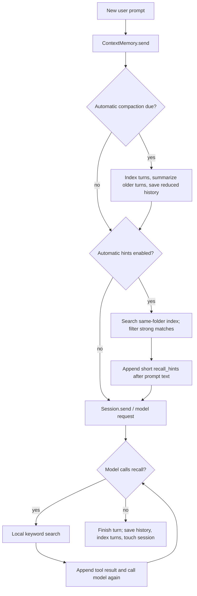

# Context memory: turn storage, compaction and recall

`context-memory` keeps a long conversation usable without sending its entire history on every request. **Compaction decides what stays in the active conversation; recall finds earlier details when they are needed again.** The two mechanisms share a turn index in the session database.

This guide describes the kernel implementation introduced in 0.16.0, checked against the source on 2026-11-25. It is a library contract, not a claim that every consuming app has enabled it. The card is headless: the app supplies its settings, turn-selection UI, persistence lifecycle and error display.

## 1. Three different kinds of memory

| Layer | Owner | What it contains | Sent to the model? |
|---|---|---|---|
| Active conversation | `agent-loop` / `Session` | System instruction, current summary, retained turns, tool exchanges and new prompts | Yes, through the model adapter |
| Saved conversation | `session-store` / `Store` | Session metadata and the active message history, excluding the system instruction | Loaded when the app reopens the session; not searched as a whole on every request |
| Searchable turn index | `context-memory` / `TurnIndex` | Bounded prompt and final-answer text, tool names, session and original turn number | Only matching pointers or tool results are added to a request |

The index is **SQLite FTS5 keyword search, not embeddings or a vector database**. There is no embedding call, external retrieval service, autonomous fact extraction, or global user-profile memory.



The busy-session queue is an exception to this flow; see [lifecycle and limitations](#8-lifecycle-errors-and-current-limitations).

## 2. How turns are stored

### A turn is larger than a message

`splitHistoryTurns(history)` starts a turn at a real user message and includes subsequent assistant messages, tool calls/results and notifications until the next real user message. A leading compaction summary and its acknowledgement do not count as a turn. A message beginning with `<system_notification>` does not start a new turn.

For example, a user request followed by three tool calls and a final answer is one conversation turn, not five. Turn-selection plans use **zero-based positions in the current live history**. Recall displays **one-based original turn numbers**. These are different after compaction.

### Tables in the same SQLite file

`new Store(dir)` opens `dir/neovai.db` by default. Constructing `ContextMemory` adds these tables through `store.database`; it does not create a second database:

| Table | Important columns / purpose |
|---|---|
| `sessions` | Existing store table: `id`, `title`, `cwd`, `model`, `created_at`, `updated_at` |
| `messages` | Existing store table: ordered `content_json` for the active history |
| `turn_index` | `id`, `session_id`, `turn`, `user_text`, `answer_text`, `tools`, `ts`; unique `(session_id, turn)` |
| `turn_fts` | External-content FTS5 index over prompt, answer and tool names, using `porter unicode61` |
| `turn_maps` | `session_id` and JSON `map`: original numbers of the turns retained by compaction |

Indexing changes only new or changed entries. A changed entry is deleted and reinserted so the FTS insert/delete triggers stay in sync. Entries absent from the live history are deliberately retained.

The indexed text is **not a full-fidelity transcript backup**:

| Field | Current representation |
|---|---|
| User prompt | Whitespace flattened; first 2,000 characters, plus an ellipsis if clipped |
| Assistant answer | Last nonempty assistant text in the turn; whitespace flattened; first 4,000 characters, plus ellipsis |
| Tools | Unique tool names, not their arguments or output bodies |
| Text attachments | Attachment name retained as `[attached: name]`; body excluded from the user-text index |
| Images | Text marker / caption, not searchable image bytes or OCR |
| Harness additions | `<recall_hints>` and system-notification blocks removed from indexed user text |
| Timestamp | Time the entry was indexed or changed; backfill uses the session's `updated_at`, not an original per-turn timestamp |

Ordinary saved messages can still contain full tool results and attachments while those turns remain in active history. After compaction replaces that history, the index alone cannot reconstruct those bodies. Attachment content repeated in an assistant answer can still enter the answer index; this is not a redaction system.

## 3. Compaction by turns

### Manual selection: keep, summarize, drop

`memory.analyze(session)` returns turn digests, estimated sizes and topic clusters. It **does not choose a compaction plan**. The app lets the user assign each turn to an action, then calls:

```ts
const analysis = await memory.analyze(session)
// The app displays analysis.turns and analysis.clusters for user selection.
const plan = { keep: [3], summarize: [0, 2] }
const result = await memory.compact(chatId, session, plan)
```

For a four-turn live history, this means:

| Live index | Display position before this compaction | Action |
|---|---|---|
| `0` | First live turn | Summarize |
| `1` | Second live turn | Drop |
| `2` | Third live turn | Summarize |
| `3` | Fourth live turn | Keep verbatim |

Any turn in neither list is dropped. If a turn appears in both lists, **keep wins**. Kept turns remain in their original order, including their tool exchanges; they need not be adjacent. Dropped turns are omitted from the new summary input, but their indexed text remains recallable. **Drop means remove from active context, not permanently forget.**

Topic analysis asks the configured compaction model to group related, even nonadjacent, turns. It normalizes duplicate or missing assignments. For two or fewer turns, or failed/invalid model output, it uses lexical clustering. With a separate compaction model, analysis can retry on the chat model before returning the lexical fallback.

### What happens inside `compact`

1. Capture the live-to-original turn map and index the current history before removing anything.
2. Enter `Session.exclusive`; compaction refuses a busy session.
3. Separate kept, summarized and dropped turns.
4. Summarize only the selected turns, merging the prior summary when present.
5. Replace active history with a summary user message, a fixed assistant acknowledgement, and all kept turns verbatim. The system instruction remains unchanged.
6. Save the retained turn map and replacement message history.
7. Return `CompactResult`: estimated `before` / `after` tokens, summarized and dropped counts, summary text, model, and original `keptTurns` / `compactedTurns`.

If nothing is removed, the result has `model: ''` and no summary call is made. If there are only dropped turns, `summarizeTurns` returns the existing summary without calling a model. If no summary exists and none is produced, no summary/acknowledgement or `<recall_note>` is inserted.

The summary request uses `reasoning: 'off'` and no tools. Its instruction asks for goals, preferences, facts and numbers, decisions and reasons, important files/commands, tool outcomes, and open work. Selected transcripts include clipped tool arguments and results, unlike the search index.

Current per-item summary-input caps are 8,000 characters for the turn's opening user text, 6,000 for each assistant text, 600 for each tool-call argument string, 1,500 for each tool result, and 800 for a subsequent notification. There is no multi-stage batching of an oversized summarization request. The summary is lossy even though its instruction asks not to lose important details.

`compactModel()` optionally selects a cheaper model. A failed summary call falls back to the chat's model when the two differ. If both fail, manual `compact` rejects. Model usage is emitted through the session hooks with `agentId: 'compact'`.

### Actual summary request and rewritten history

The following examples were captured through `ContextMemory.compact`, `ContextMemory.send` and `Session` using synthetic turns and a deterministic model adapter. They show actual backend serialization, **not production traffic or proof of a live model's recall choices**. For a real run through SuperTM Desktop with a live model, see [section 11](#11-live-capture-from-supertm-desktop). The adapter intentionally returns an incomplete summary to demonstrate how recall recovers a missing number.

Initial history:

```json
[
  {"role":"user","content":"Pick the retry threshold for job 552."},
  {"role":"assistant","content":"We chose 7 attempts for job 552, then alert the operator."},
  {"role":"user","content":"Build the status chart."},
  {"role":"assistant","content":"The status chart is ready."}
]
```

Plan: `{ keep: [1], summarize: [0] }`. Here is the full normalized request passed to the summary adapter; `example-model` is a fixture label, not a configured provider model:

```json
{
  "model": "example-model",
  "messages": [
    {
      "role": "system",
      "content": "You compress conversation history into working memory for an AI agent that will continue the conversation."
    },
    {
      "role": "user",
      "content": "Summarize the turns below into a dense Markdown memory the agent can rely on instead of the raw turns. Keep: the user's goals and preferences, key facts and numbers, decisions and their reasons, files/paths/commands that matter, results of tool runs, and open questions or next steps. Group by topic. Omit pleasantries and dead ends unless they explain a decision. Be concise but lose nothing important.\n\n### Turn 1\nUSER: Pick the retry threshold for job 552.\nASSISTANT: We chose 7 attempts for job 552, then alert the operator."
    }
  ],
  "reasoning": "off"
}
```

The fixture returns `Retry policy was agreed; consult earlier turns for the exact threshold.` The resulting saved history is:

```json
[
  {
    "role": "user",
    "content": "<compacted_history>\nSummary of the earlier conversation (older turns were compacted):\n\nRetry policy was agreed; consult earlier turns for the exact threshold.\n</compacted_history>\n<recall_note>1 earlier turn was removed from this conversation. The summary above is lossy; the original prompts and answers can still be searched with the recall tool.</recall_note>"
  },
  {
    "role": "assistant",
    "content": "Understood. I have the summary of the earlier conversation and will build on it."
  },
  {"role":"user","content":"Build the status chart."},
  {"role":"assistant","content":"The status chart is ready."}
]
```

The original retry answer is now absent from active context, but remains in `turn_index`. The wording "original prompts and answers" in the recall note refers to the bounded indexed text, not an unlimited archive.

### Automatic compaction

Automatic compaction is separate from automatic recall hints. The host supplies all six settings; these are example values, not built-in defaults:

```ts
const auto = {
  mode: 'auto' as const,
  threshold: 120_000,
  hardLimit: 160_000,
  idleMinutes: 5,
  keepRecent: 6,
  minGain: 20_000
}
await memory.send(chatId, session, prompt, {
  auto,
  onCompact: showCompactionResult,
  onError: showMemoryError
})
```

Before adding the new prompt, `send` evaluates these gates in order:

| Gate | Outcome |
|---|---|
| Mode is not `auto` | No compaction; reason `off` |
| Estimated tokens are **at or below** `threshold` | `under-threshold` |
| There are no turns before the retained `keepRecent` suffix | `too-few-turns` |
| Estimated size of turns to summarize is less than `minGain` | `small-gain` |
| Positive `hardLimit` reached | Compact, reason `hard-limit`, even without idle time |
| `idleMinutes <= 0` | Compact, reason `no-wait` |
| Idle duration reached | Compact, reason `idle` |
| Otherwise | Wait; reason `cache-warm` |

The automatic plan keeps the last `keepRecent` turns and summarizes every earlier live turn. It does not choose topics or drop selected topics.

Important qualifications:

- `suggest` currently behaves like `off` in the decision function. The card does not display or emit a suggestion; a host must implement suggestion UX.
- Idle time is computed from the stored session `updated_at`. It is a heuristic, not a provider cache-status query.
- `gain` is the estimated size of the turns to summarize, **not net savings after the new summary**.
- Token estimates use roughly serialized characters / 4, with 1,600 tokens per image. They exclude tool schemas and the not-yet-added prompt/attachments. `hardLimit` is therefore not an enforced provider context limit and does not bypass the earlier gates.
- The host should validate settings and reserve room for incoming content, tools and model output.

## 4. Recall modes: Auto Pin versus agent trigger

**"Auto Pin" is a useful UI label for automatic recall hints.** The kernel calls this `hints`; it has no persistent pin/unpin collection and does not automatically paste full retrieved answers.

| Configuration | Before the first model call | Can the agent call `recall`? |
|---|---|---|
| Recall not wired | No recall instruction, tool or automatic hints | No |
| Agent-trigger only: tool + instruction wired, `hints: () => false` | Normal prompt, without `<recall_hints>` | Yes, whenever the model decides |
| Auto Pin + agent trigger: tool + instruction wired, hints enabled | Append short pointers **only if strong matches exist** | Yes; the tool fetches the matching answer excerpts |

Hints default to enabled when the `hints` callback is omitted. Disabling hints does **not** remove the tool, clear the index, or disable compaction. Conversely, a host must actually register the tool and append `RECALL_PROMPT`; constructing `ContextMemory` alone does not alter a session's tool list or system prompt.

### Automatic hint selection

`memory.hints(chatId, prompt)`:

1. Refreshes the current chat's index and searches chats whose stored `cwd` exactly matches this chat's folder.
2. Excludes the newest **20 live turns of the current chat**, since they are already nearby in context. Compacted turns and older live turns can still qualify; other chats do not have this exclusion.
3. Considers up to 12 returned candidates.
4. Requires at least **two matched query terms** and **50% query-term coverage**, using a lightweight stemmed keyword comparison over prompt and answer.
5. Attaches at most **four** one-line pointers. Each shows a location and up to 110 characters of the indexed user prompt, or answer if the prompt is empty.

No qualifying match means no block. A one-keyword prompt cannot pass the default automatic gate, but the agent can still call the tool with that keyword. A pointer can match because of answer text even though only the original user prompt appears in the pointer.

Hints contain either `this chat, turn N (still in the conversation above)`, `this chat, turn N (removed by compaction)`, or another chat's title, turn and indexed date.

### What makes the agent know when to recall?

The stable system instruction includes this exported `RECALL_PROMPT`:

```text
# Recall
Every turn of every chat is kept in a searchable index, including turns that compaction removed from this conversation. Use the recall tool when the user refers to something you cannot see (an earlier decision, number, file, name or result), when a compaction summary lacks a detail you need, or when earlier work in this folder would help — and before asking the user to repeat something. Recall is not limited to this chat: when the user or the session memory names another chat ("the Vertex Model session"), call recall with that name in "chat" plus keywords. A <recall_hints> block after a prompt lists earlier turns that matched it by keyword; it is added automatically, is not written by the user, and may be irrelevant.
```

The tool description repeats these triggers. The summary's `<recall_note>` provides another reminder. This is guidance, **not a guarantee** that any particular model will call recall.

## 5. Backend requests: without hints, with Auto Pin, then tool recall

Continuing the captured example from section 3, the user asks: `What retry threshold did we choose?`

### Shared request envelope

The engine uses a provider-neutral `ChatRequest`. The request contains the stable system instruction, compacted history, newest user message and tool schemas:

```ts
// Request shape; named variables stand for the captured content shown below.
{
  model: 'example-model',
  messages: [
    { role: 'system', content: appInstruction + '\n\n' + RECALL_PROMPT },
    ...compactedHistory,
    newestUserMessage
  ],
  tools: toSchemas([memory.tool(chatId)]),
  reasoning: 'medium'
}
```

`toSchemas` adds the harness's plain-language `intent` argument to the tool schema. Recall accepts `query` (required), `scope`, `chat`, and `limit`. The tool is present in **both** agent-only and Auto Pin modes; the difference below is the newest user message.

### A. Without automatic hints: agent-trigger only

The captured final message of the first request is exactly:

```json
{
  "role": "user",
  "content": "What retry threshold did we choose?"
}
```

The system instruction and summary note still tell the model to recall missing details. No automatic search excerpt has been added. The model can call `recall` on its own, or fail to do so; the host does not force a call.

If recall were entirely unwired instead, this user message would look identical, but the request would have no recall tool or recall system section. A stale summary note is not enough to make an unavailable tool work.

### B. With Auto Pin: pointer appended to that same user message

```json
{
  "role": "user",
  "content": "What retry threshold did we choose?\n\n<recall_hints>\nEarlier turns that may relate to this request (keyword match, added automatically — ignore them if they don't help). Call the recall tool to read one that is not in the conversation.\n- this chat, turn 1 (removed by compaction): \"Pick the retry threshold for job 552.\"\n</recall_hints>"
}
```

Notice what is **not** there: `7 attempts`. Auto Pin points to a useful turn; it does not yet fetch the answer into context. There is no extra model call to choose these hints; matching and formatting are local code.

For text-only messages the block comes after the prompt and any text attachments. With image attachments, it is at the end of the first text block, **before the image captions/blocks**, not literally the last byte of the complete request.

### C. Agent-triggered recall: assistant tool call, local search, next request

The fixture adapter emits this assistant message. The same exchange works whether or not Auto Pin ran:

```json
{
  "role": "assistant",
  "content": null,
  "tool_calls": [
    {
      "id": "call_recall_1",
      "type": "function",
      "function": {
        "name": "recall",
        "arguments": "{\"intent\":\"Find the earlier retry decision\",\"query\":\"retry threshold\",\"scope\":\"session\",\"limit\":5}"
      }
    }
  ]
}
```

The engine strips `intent` before executing the tool. SQLite search produces this captured tool message:

```json
{
  "role": "tool",
  "tool_call_id": "call_recall_1",
  "content": "[1] this chat, turn 3 (still in the conversation above)\nUSER: What retry threshold did we choose?\n(The full turn is in the conversation above.)\n\n[2] this chat, turn 1 (removed by compaction)\nUSER: Pick the retry threshold for job 552.\nASSISTANT: We chose 7 attempts for job 552, then alert the operator."
}
```

This intentionally shows a current implementation detail: an explicit search can match the in-progress user turn itself. The tool does not apply the automatic hints' recent-turn exclusion.

The next request is:

```text
same system instruction
same compacted history
same user message (with or without its existing hints)
assistant tool_calls message
tool result message
```

Now the model sees `7 attempts` and can answer with it. The search did not call a separate LLM, but processing the tool result requires another model request in the normal agent loop. The adapter's scripted final answer was `We chose 7 attempts for job 552, then alert the operator.` This fixture verifies data flow, not model reasoning quality.

For a hit still in the current conversation, the formatter returns at most 200 prompt characters and a pointer to the full turn above. For a compacted turn or another chat, it returns up to 600 prompt characters, 1,500 answer characters and the tool names, with ellipses when clipped.

### D. Claude / Anthropic wire format

The examples above are the kernel's normalized messages, not universally identical HTTP bodies. The Anthropic adapter moves system text into top-level `system`, converts `tool_calls` to `tool_use`, and converts a tool reply into a **user-role `tool_result` block**.

These are the two appended wire messages from the same captured exchange, converted with the default five-minute cache setting:

```json
[
  {
    "role": "assistant",
    "content": [
      {
        "type": "tool_use",
        "id": "call_recall_1",
        "name": "recall",
        "input": {
          "intent": "Find the earlier retry decision",
          "query": "retry threshold",
          "scope": "session",
          "limit": 5
        }
      }
    ]
  },
  {
    "role": "user",
    "content": [
      {
        "type": "tool_result",
        "tool_use_id": "call_recall_1",
        "content": [
          {
            "type": "text",
            "text": "[1] this chat, turn 3 (still in the conversation above)\nUSER: What retry threshold did we choose?\n(The full turn is in the conversation above.)\n\n[2] this chat, turn 1 (removed by compaction)\nUSER: Pick the retry threshold for job 552.\nASSISTANT: We chose 7 attempts for job 552, then alert the operator."
          }
        ],
        "cache_control": {"type":"ephemeral"}
      }
    ]
  }
]
```

The earlier messages, top-level system/tools, output budget and provider-specific envelope are omitted from this wire excerpt. `toAnthropic` also merges adjacent messages of the same role. Other adapters can use different envelopes, including OpenAI Responses function-call items.

## 6. Search scopes and cross-session recall

| Tool argument | Behavior |
|---|---|
| `query` | Specific keywords; at least one usable term of two or more characters |
| `scope: "session"` | This chat only; default |
| `scope: "folder"` | All indexed chats with exactly the same stored `cwd` |
| `scope: "all"` | All indexed chats in this database, not all applications or machines |
| `chat: "Retry design"` | Case-insensitive title match across folders; overrides `scope` |
| `limit` | Default 5; rounded and clamped to 1-10 |

For example, if the user **or an existing session summary** names another conversation:

```json
{
  "intent": "Find the earlier retry decision",
  "query": "retry threshold",
  "chat": "Retry design",
  "limit": 5
}
```

Exact title matches take precedence over substring matches. Among those matches, other chats are preferred over the current chat; the current chat is included only if there are no other matches. At most 20 matched chats are searched, with named-chat discovery limited by the store's newest 1,000 sessions. Named targets are refreshed before searching.

An unknown name returns a diagnostic listing up to 30 recent titles and asks the model to retry a name or use `scope: "all"`. A known name with no keyword hits produces a different no-match message. Title matching does not use semantic aliases.

FTS search extracts lower-case ASCII words/numbers, removes common stop words and joins at most 24 quoted terms with `OR`. It ranks with `bm25(turn_fts, 2.0, 1.0, 0.5)`, weighting user text more than answer text and tool names, then uses descending index timestamp for ties. Recall has no minimum-coverage gate; that stricter filter belongs only to automatic hints. Synonyms, non-Latin queries and vague references may therefore need another query.

These scopes are retrieval filters, **not authorization boundaries**. The built-in recall tool has no permission gate. A multi-user or sensitive-data host must isolate stores or restrict access before exposing cross-session search. Local storage does not make recalled content local-only: attached pointers and tool results are sent to the configured model provider.

## 7. Prompt caching: what changes and what remains stable

Prompt caching reuses provider-side computation for a matching request prefix. It is not a searchable archive and cannot supply turns that the host has removed from a request.

```text
Before new prompt:
  [stable tools] [stable system] [existing conversation]

Agent-only request:
  [stable tools] [stable system] [existing conversation] [new prompt]

Auto Pin request:
  [stable tools] [stable system] [existing conversation] [new prompt + hints]

After recall tool execution:
  [same prefix and user message] [assistant tool call] [tool result]

After compaction:
  [stable tools] [stable system] [NEW summary + retained turns] [new prompt]
```

Hints do not get inserted into the early system instruction or rewrite old messages. Once added, they persist with that user message in saved history; the card does not recompute old hint blocks on every call. Indexing strips them so they are not indexed as if the user wrote them.

This placement preserves the *opportunity* to reuse the earlier prefix. It does not promise a cache hit: provider/model support, minimum cacheable length, expiry, breakpoint placement and changes to tools/system still matter. New suffix tokens, including hints and recall results, still cost tokens and occupy context.

The Anthropic mapper supports cache settings `5m`, `1h` and `off`. It marks the last tool, the system text, the final message's last nonempty block, and a previous user-message block. The idle setting for auto-compaction is independent; the host should align it with its actual provider policy rather than assuming every cache expires after five minutes.

Compaction rewrites the history prefix starting at the summary. Tools/system may remain reusable, but the replaced conversation segment cannot reuse its old prefix computation. That is why the automatic policy can wait for idle time unless the hard-limit gate is reached.

Use recall when a needed fact is absent or hard to locate; keep inexpensive, useful recent context directly available. Recall and caching complement each other rather than replace each other.

## 8. Lifecycle, errors and current limitations

| Operation | Host responsibility / current behavior |
|---|---|
| Create or reopen a chat | Create its `sessions` row first; load saved history into `Session`; register the tool and stable recall instruction |
| Normal user send | Use `memory.send` to apply memory, then save, index and touch the session |
| Startup migration | Await `memory.backfill()`; it prunes orphan rows and indexes chats with messages but no index rows, 20 chats per batch with a 50 ms pause by default |
| Direct history edits or background runs | Save and call `memory.indexTurns` at the appropriate lifecycle point; `ContextMemory` is not a universal observer of every `Session.send` or `notify` |
| Delete a chat | Call `store.deleteSession(id)` and `memory.index.forget(id)`; store deletion does not remove the card's tables itself |
| Deleted but not yet pruned | Search joins `sessions`, so orphaned entries are hidden; their text still exists on disk until forgotten/pruned |
| Fully disable recall | Disable hints and remove the tool/system guidance; handle any existing recall notes in history appropriately |

Important limits to account for:

- **No recovery of already-lost history.** Backfill only sees saved active messages, not old desktop transcript archives or turns removed before indexing existed. It skips partially indexed chats rather than doing a complete consistency scan.
- **Best-effort indexing and hints.** `indexTurns` catches errors and returns zero; hints catch errors and return an empty string. Backfill skips per-chat errors and returns the number of candidate chats, not a certified count of successful writes. The exported prompt's "every turn" wording expresses the intended workflow, not a durability guarantee.
- **Automatic compaction errors.** `send` reports them only if the host supplies `onError`, then proceeds with the send. A failed compaction does not guarantee the remaining request will fit the provider limit.
- **Busy sessions.** `analyze` and `compact` require an idle session. A `memory.send` while busy delegates to the ordinary queue without auto-compaction or hints. That early-return path does not independently save/index; the active outer memory send normally does so when it finishes. A host that runs sessions through other paths must handle persistence.
- **Not one atomic transaction.** History replacement, turn-map writes and message persistence are separate steps. A persistence failure needs host recovery; do not present compaction as a database-wide atomic operation.
- **Turn-number edge case.** New original numbers continue from the last retained turn, not a separate historical high-water mark. If a manual plan removes the newest turns, or keeps none, later numbering can overlap older indexed turns and replace entries. Until this is addressed, retain the newest turn/suffix for chats that will continue. The usual `keepRecent > 0` automatic plan follows that pattern.
- **No permanent pins or exact-turn fetch API.** Hints are pointers; `recall` accepts keywords and scope/name, not a session ID plus turn-number lookup. It returns bounded excerpts, not paginated full transcripts.
- **No automatic truth reconciliation.** An indexed assistant answer may be wrong or superseded. Use its source location and current evidence; recalled content is historical data, not new authorization or a higher-priority instruction.

## 9. App integration

These fragments use host-owned `store`, `sessions`, settings, UI callbacks and existing session options:

```ts
import { ContextMemory, RECALL_PROMPT } from 'neovai-kernel/cards/context-memory'
import { Session } from 'neovai-kernel/cards/agent-loop'

const memory = new ContextMemory({
  store,
  session: (id) => sessions.get(id),
  hints: () => settings.recallHints,
  compactModel: () => settings.compactModel
})

// Run after opening the database and before relying on old-chat search.
await memory.backfill()

// The session row already exists. sessionOptions supplies adapter, model,
// hooks, permission gate and cwd; system/tools below extend the app's own.
const session = new Session({
  ...sessionOptions,
  system: () => appSystem() + '\n\n' + RECALL_PROMPT,
  tools: () => [...appTools(), memory.tool(chatId)],
  history: store.loadMessages(chatId)
})
sessions.set(chatId, session)

await memory.send(chatId, session, prompt, {
  attachments,
  auto: settings.autoCompact,
  onCompact: showCompactionResult,
  onError: showMemoryError
})

// The host serializes these operations with sends and shows rejected errors.
const analysis = await memory.analyze(session)
const plan = await chooseTurnsInUi(analysis)
if (plan) {
  const result = await memory.compact(chatId, session, plan)
  showCompactionResult(result)
}

// On deletion, after stopping/settling any live work:
store.deleteSession(chatId)
memory.index.forget(chatId)
sessions.delete(chatId)
```

Declare `context-memory`, `agent-loop` and `session-store` in the host's composed cards. There is no ready-made compaction React panel in this card. A host should show the proposed keep/summarize/drop choices, distinguish live positions from original recall numbers, make errors visible, and avoid treating "drop" as a privacy deletion control.

## 10. Source map

| Source | What to inspect |
|---|---|
| [`memory.ts`](../cards/context-memory/memory.ts) | `ContextMemory`, send lifecycle, hints, compaction, model fallback and backfill |
| [`compact.ts`](../cards/context-memory/compact.ts) | Turn splitting, plans, clustering, summary request, history rewrite and automatic policy |
| [`recall.ts`](../cards/context-memory/recall.ts) | Index-entry normalization, hint gates, tool schema, exact prompt and result formatting |
| [`turn-index.ts`](../cards/context-memory/turn-index.ts) | SQLite schema, FTS ranking, title matching and turn maps |
| [`session.ts`](../cards/agent-loop/session.ts), [`content.ts`](../cards/agent-loop/content.ts) | Exclusive history access, queueing and placement of hint text |
| [`loop.ts`](../cards/agent-loop/loop.ts), [`tool.ts`](../cards/agent-loop/tool.ts) | Tool schema injection, execution and next model request |
| [`store.ts`](../cards/session-store/store.ts) | Saved messages, session metadata and deletion lifecycle |
| [`anthropic.ts`](../cards/model-providers/anthropic.ts) | Anthropic message conversion and cache breakpoints |
| [`compact.test.ts`](../cards/context-memory/compact.test.ts), [`recall.test.ts`](../cards/context-memory/recall.test.ts) | Existing coverage of plans, persistence, scopes, hints, fallback and recall after compaction |

## 11. Live capture from SuperTM Desktop

Sections 3 and 5 use a scripted fixture. This section is different: it is one real run through SuperTM Desktop with a live model. The desktop has its own copy of this feature (the kernel card was extracted from it), so table and setting names can differ from the kernel's.

| | |
|---|---|
| App | SuperTM Desktop 1.4.4, commit `5506b30`, Electron 45.3.2, macOS arm64 |
| Model | `anthropic/claude-sonnet-5-5` on Vertex AI, `streamRawPredict` |
| Date | 2026-11-25 |
| Setup | Fresh, isolated app home with one new chat; auto-compaction off |
| Capture | `fetch` was wrapped in the app's main process at run time and each request body to Vertex was logged. No app source was changed. Headers were not recorded |
| Edits to the excerpts | System prompt (4,786 chars) and the 18 other tool definitions are trimmed; the project id is redacted. Message content is verbatim |

This is a single run of a deliberately tiny, throwaway conversation. It shows what the app sends; it does not measure how often a model chooses to recall.

### Step 1. Four ordinary turns (no compaction, no recall)

Four prompts were sent, each recording one decision about a demo service called "lighthouse". The fourth request, as sent:

```json
{
  "messages": [
    { "role": "user", "content": [{ "type": "text", "text": "We are planning a small demo service called \"lighthouse\". Decision 1: the nightly export job retries at most 7 times with a 45 second backoff. Just acknowledge in one sentence, no tools." }] },
    { "role": "assistant", "content": [{ "type": "text", "text": "Noted: for the \"lighthouse\" demo service, the nightly export job will retry at most 7 times with a 45-second backoff between attempts." }] },
    { "role": "user", "content": [{ "type": "text", "text": "Decision 2: the lighthouse status chart uses teal for success and amber for retrying. Acknowledge in one sentence, no tools." }] },
    { "role": "assistant", "content": [{ "type": "text", "text": "Noted: in the lighthouse status chart, teal marks success and amber marks retrying." }] },
    { "role": "user", "content": [{ "type": "text", "text": "Decision 3: the on-call alias for lighthouse is harbor-team and reports go out Tuesdays. Acknowledge in one sentence, no tools.", "cache_control": { "type": "ephemeral" } }] },
    { "role": "assistant", "content": [{ "type": "text", "text": "Noted: lighthouse's on-call alias is harbor-team, and reports go out on Tuesdays." }] },
    { "role": "user", "content": [{ "type": "text", "text": "Decision 4: logs are kept for 30 days. Acknowledge in one sentence, no tools.", "cache_control": { "type": "ephemeral" } }] }
  ],
  "max_tokens": 128000,
  "system": "[trimmed: 4786 chars of system prompt]",
  "thinking": { "type": "adaptive", "display": "summarized" },
  "output_config": { "effort": "medium" },
  "tools": ["[trimmed: 18 other tools]", { "name": "recall", "description": "[shown below]" }],
  "anthropic_version": "vertex-2023-10-16",
  "stream": true
}
```

The whole history is sent every time. The `recall` tool is already in `tools` on every agent request, before any compaction and with Auto Pin off. Its definition as sent:

```json
{
  "name": "recall",
  "description": "Search earlier turns of this chat and of other chats (prompts and final answers) by keyword. Finds turns that compaction removed from the conversation and work done in other chats. To search a chat the user or the session memory refers to by name, pass its name in `chat`. Use it when the user refers to something not visible in the conversation, when a summary is missing a detail, or before asking the user to repeat a fact. Results give the prompt and the answer of each matching turn; tool output is not stored. Use specific keywords (names, numbers, file names), not a full question.",
  "input_schema": {
    "type": "object",
    "properties": {
      "query": { "type": "string", "description": "Keywords to look for, e.g. \"retry limit decision\" or a file name" },
      "scope": { "type": "string", "enum": ["session", "folder", "all"], "description": "session = this chat only (default); folder = every chat in this working folder; all = every chat" },
      "chat": { "type": "string", "description": "Name (or part of the name) of another chat to search, as the user wrote it, e.g. \"Vertex Model\". Searches that chat in any folder; scope is ignored." },
      "limit": { "type": "number", "description": "Maximum results (default 5, at most 10)" }
    },
    "required": ["query"]
  }
}
```

### Step 2. Compaction

"Analyze" sent one request without tools (system: `You organize chat transcripts. Reply with JSON only, no prose.`) and the model put all four turns in one cluster, "Lighthouse service decisions". The plan was then set by hand: **drop turn 1, summarize turns 2 and 3, keep turn 4** (the app's API numbers them from 0: `{ keep: [3], summarize: [1, 2] }`).

The summary request, complete apart from the envelope fields:

```json
{
  "system": [{ "type": "text", "text": "You compress conversation history into working memory for an AI agent that will continue the conversation.", "cache_control": { "type": "ephemeral" } }],
  "messages": [{
    "role": "user",
    "content": [{
      "type": "text",
      "text": "Summarize the turns below into a dense Markdown memory the agent can rely on instead of the raw turns. Keep: the user's goals and preferences, key facts and numbers, decisions and their reasons, files/paths/commands that matter, results of tool runs, and open questions or next steps. Group by topic. Omit pleasantries and dead ends unless they explain a decision. Be concise but lose nothing important.\n\n### Turn 2\nUSER: Decision 2: the lighthouse status chart uses teal for success and amber for retrying. Acknowledge in one sentence, no tools.\nASSISTANT: Noted: in the lighthouse status chart, teal marks success and amber marks retrying.\n\n### Turn 3\nUSER: Decision 3: the on-call alias for lighthouse is harbor-team and reports go out Tuesdays. Acknowledge in one sentence, no tools.\nASSISTANT: Noted: lighthouse's on-call alias is harbor-team, and reports go out on Tuesdays.",
      "cache_control": { "type": "ephemeral" }
    }]
  }]
}
```

Only the turns marked "summarize" are sent. The dropped turn never reaches the summarizer, so Decision 1 (7 retries, 45-second backoff) is now absent from the active conversation. It survives only in the turn index.

The app reported `before: 1494`, `after: 1551` estimated tokens, with 2 turns summarized, 1 dropped and 1 kept. **The history grew.** A structured summary plus the recall note is longer than two one-sentence exchanges. Compaction pays off on long turns with tool output, not on a chat this small.

### Step 3. The same question after compaction, Auto Pin off (agent trigger)

Question: `What retry limit and backoff did we choose for the nightly export job?` The request as sent (envelope as in step 1):

```json
[
  { "role": "user", "content": [{ "type": "text", "text": "<compacted_history>\nSummary of the earlier conversation (older turns were compacted):\n\n# Working memory: lighthouse project\n\n## Decisions recorded\n- **Decision 2 (status chart colors):** The lighthouse status chart uses **teal = success** and **amber = retrying**.\n- **Decision 3 (on-call and reporting):** The lighthouse on-call alias is **harbor-team**. Reports go out **Tuesdays**.\n\n## Interaction notes\n- For these \"Decision N\" messages, the user wants a **one-sentence acknowledgment with no tool use**. Both were acknowledged that way.\n- No files, commands, or tool runs have been involved so far.\n\n## Gaps and open items\n- Decision 1 is not in the provided turns, so its content is unknown. Ask the user if it becomes relevant.\n- No open questions or next steps have been stated.\n</compacted_history>\n<recall_note>3 earlier turns were removed from this conversation. The summary above is lossy; the original prompts and answers can still be searched with the recall tool.</recall_note>" }] },
  { "role": "assistant", "content": [{ "type": "text", "text": "Understood. I have the summary of the earlier conversation and will build on it." }] },
  { "role": "user", "content": [{ "type": "text", "text": "Decision 4: logs are kept for 30 days. Acknowledge in one sentence, no tools." }] },
  { "role": "assistant", "content": [{ "type": "text", "text": "Noted: lighthouse logs will be kept for 30 days." }] },
  { "role": "user", "content": [{ "type": "text", "text": "What retry limit and backoff did we choose for the nightly export job?", "cache_control": { "type": "ephemeral" } }] }
]
```

Nothing in this request contains the answer. The user message is exactly what was typed. The model replied with a tool call instead of text, and the app ran the search locally and sent a second request with these two messages appended:

```json
[
  { "role": "assistant", "content": [{ "type": "tool_use", "id": "toolu_vrtx_01QQNLgdeWtAmEBmfgo7Eb3u", "name": "recall", "input": { "query": "retry limit backoff nightly export job", "scope": "folder" } }] },
  { "role": "user", "content": [{ "type": "tool_result", "tool_use_id": "toolu_vrtx_01QQNLgdeWtAmEBmfgo7Eb3u", "cache_control": { "type": "ephemeral" }, "content": [{ "type": "text", "text": "[1] this chat, turn 5 (still in the conversation above)\nUSER: What retry limit and backoff did we choose for the nightly export job?\n(The full turn is in the conversation above.)\n\n[2] this chat, turn 1 (removed by compaction)\nUSER: We are planning a small demo service called \"lighthouse\". Decision 1: the nightly export job retries at most 7 times with a 45 second backoff. Just acknowledge in one sentence, no tools.\nASSISTANT: Noted: for the \"lighthouse\" demo service, the nightly export job will retry at most 7 times with a 45-second backoff between attempts.\n\n[3] this chat, turn 2 (removed by compaction)\nUSER: Decision 2: the lighthouse status chart uses teal for success and amber for retrying. Acknowledge in one sentence, no tools.\nASSISTANT: Noted: in the lighthouse status chart, teal marks success and amber marks retrying." }] }] }
]
```

Final answer: `The nightly export job retries at most **7 times**, with a **45-second backoff** between attempts. That was Decision 1.`

### Step 4. The same question, Auto Pin on

A second app instance was started on a copy of the database taken right after step 2, with the recall-hints setting on. Same question. The request is identical to step 3 except for the last user message:

```json
{ "role": "user", "content": [{ "type": "text", "text": "What retry limit and backoff did we choose for the nightly export job?\n\n<recall_hints>\nEarlier turns that may relate to this request (keyword match, added automatically — ignore them if they don't help). Call the recall tool to read one that is not in the conversation.\n- this chat, turn 1 (removed by compaction): \"We are planning a small demo service called \"lighthouse\". Decision 1: the nightly export job retries at most 7…\"\n</recall_hints>", "cache_control": { "type": "ephemeral" } }] }
```

The hint is a pointer: one line, cut off before the backoff value. It names the turn that holds the answer but does not carry the answer. The model then called the tool:

```json
{ "role": "assistant", "content": [{ "type": "tool_use", "id": "toolu_vrtx_01JGH7jQ14HqUq2KHYvLLMRd", "name": "recall", "input": { "query": "nightly export job retries backoff", "limit": 3 } }] }
```

The tool result was the same three hits as in step 3, and the final answer was `The nightly export job retries at most **7 times**, with a **45-second backoff** between attempts. You gave me this as Decision 1.`

### What this run shows

| | Auto Pin off | Auto Pin on |
|---|---|---|
| `recall` in `tools` | Yes | Yes |
| Last user message | Typed text only | Typed text plus `<recall_hints>` (1 pointer) |
| Model called `recall` | Yes, once | Yes, once |
| Requests to answer | 2 | 2 |
| Answer | Correct | Correct |

- **Both modes reached the right answer in the same number of requests.** In this run Auto Pin did not save a round trip. Its value is in telling the model that a relevant turn exists; here the `<recall_note>` and the summary's own "Decision 1 … unknown" line were already enough of a cue.
- **The model ignored the summary's advice to ask the user** and searched instead, which is what the tool description asks for.
- **The hint text is saved with the user message** in the desktop's history, so it is replayed on later requests.
- **The first search hit was the question itself** ("turn 5, still in the conversation above"). The current turn is indexed before the search runs and matches its own keywords, so it takes one result slot. With `limit: 3` that left two useful hits.
- **Turn numbers are 1-based in what the model sees** (hints, tool results, summary prompt) and 0-based in the app's compaction API.
- **A follow-up needs no second search.** The question was sent again by mistake in the Auto Pin off instance; the model answered from the tool result already in the conversation, in one request with no tool call.
- **Desktop schema.** The desktop database has `turn_index` and `turn_fts` but no `turn_maps` table; the kernel card's schema in section 2 is not identical to the desktop's.

Not covered by this run: Pearl Teammate Desktop, automatic compaction, cross-chat recall by name, and a case where the model declines to recall.

For wider host architecture, see [ARCHITECTURE.md](ARCHITECTURE.md).
