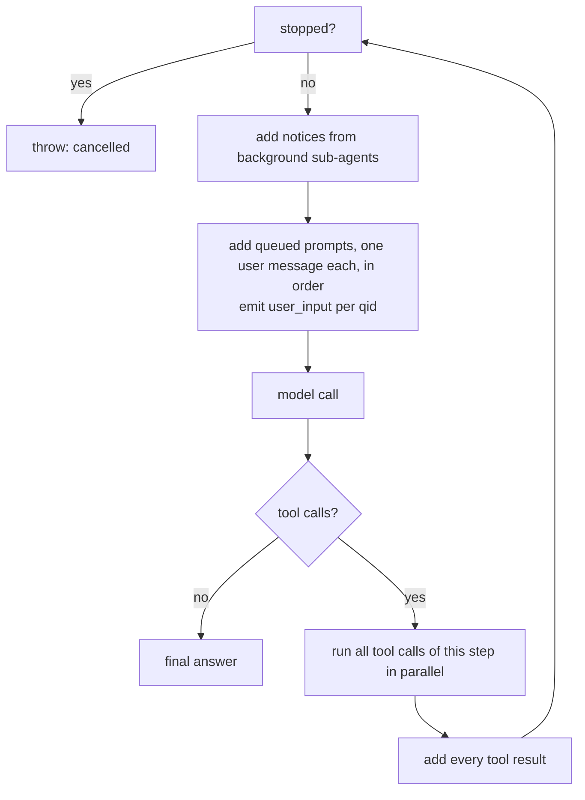
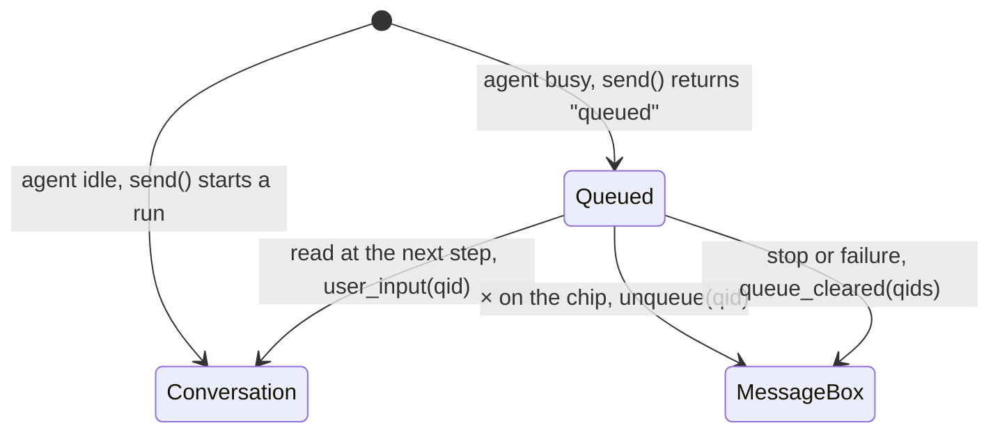

# The prompt queue: sending while the agent is working

**A prompt sent while the agent is busy waits in a queue and joins the same conversation at the agent's next step.** Nothing is interrupted and no second agent is started.

This guide describes kernel 0.20.0. The queue itself has been in `agent-loop` since the first release; 0.20.0 adds the parts a chat needs to show it: `Session.queued`, `applyChatEvent`, `queuedView`, `restoreDraft`, and the `queue` props on `Composer`.

The queue is for chats (the coding agent). A runtime-agent job run is one shot with a prepared prompt, so `runtime-agent` does not expose it.

Source: `cards/agent-loop/session.ts` (`Session.send`, the queue), `cards/agent-loop/loop.ts` (`runLoop`, where prompts join), `cards/chat-view/items.ts` (view model), `cards/chat-view/react.tsx` (`Composer`, `QueueChips`). Tests: `cards/agent-loop/loop.test.ts`, `cards/chat-view/chat-view.test.ts`, `cards/chat-view/rows.test.tsx`.

## 1. How it works

There is one conversation per chat and one main agent working on it. `Session.send()` always puts the prompt in a per-chat FIFO queue. If the session is idle it starts a run; if it is busy it returns `{ status: 'queued' }` at once.

The loop reads the queue at one place: **after every tool result of the current step is in, and before the next model call**. Each queued prompt is added there as an ordinary user message, and the model reads it together with the work done so far. The model decides what to do with it: "also do X" is folded into the current work, "stop, do Y instead" changes course at the next step.



Why only there:

- **The message order stays valid.** Providers require an assistant message with tool calls to be followed directly by one result per call. A user message between them would break the request.
- **The model never reads half-finished work.** It gets complete tool results plus the new prompt.
- **Nothing is interrupted.** Running tools, shells and sub-agents carry on. Only Stop cancels.

## 2. Lifecycle of a prompt



| Call or event | From | Meaning |
|---|---|---|
| `session.send(prompt, attachments, qid)` | app | Queues the prompt under `qid`. Returns `queued` when busy, else the run's result |
| `session.queued` | app | Prompts with a `qid` still waiting, in order (`{ qid, content }`) |
| `session.unqueue(qid)` | app | Withdraws a prompt. `false` means the model already has it |
| `user_input { qid }` | `Session` | The prompt has just joined the conversation |
| `queue_cleared { qids }` | `Session` | Stop or a failure discarded these prompts |

The `qid` is any unique string the window makes up (`crypto.randomUUID()`), so the window and the session can refer to the same prompt.

## 3. How long a prompt waits

A prompt waits until the current step ends, which is when the model call and every tool call it made have returned. So the wait is the slowest tool in that step.

| What the agent is doing | Does a queued prompt wait for it? |
|---|---|
| Streaming a model reply | Yes, until the reply ends |
| Quick tools (read, grep, write) | Yes, briefly |
| `shell` in sync mode | Yes, until the command ends or times out (default 120 s) |
| `shell` in async mode | No. The tool returns after `initial_wait`; the shell keeps running |
| A sync sub-agent (`task`) | Yes, for the whole sub-agent run |
| Several `task` calls in one step | Yes, until all return. They run in parallel, so this is the slowest one |
| A background sub-agent | No. The tool returns an id at once |
| `read_agent` with `wait: true` | Yes, until the sub-agent ends or the wait times out (default 60 s, max 600 s) |

Queued prompts go to the main agent only. A running sub-agent has its own context and never sees them. To change what a sub-agent is doing, tell the main agent; it acts at its next step.

When a background sub-agent's notice and a queued prompt arrive in the same step, the notice is added first, so the model reads "this work finished" before "here is what the user just asked".

## 4. Edge cases

| Situation | What happens |
|---|---|
| A prompt arrives while the final answer is streaming | `send()` drives the loop with `do { runLoop } while (queue or notices)`, so it runs again at once and reads the prompt. The session stays busy throughout |
| Several prompts queued | All are read in one step, in arrival order, as separate user messages |
| × on a chip after the model already took the prompt | `unqueue` returns `false`; `user_input` has moved it into the conversation, so nothing is restored |
| The window thinks the chat is busy but the run just ended | Both paths go through the same queue. The session starts a new run and reads the prompt at once |
| A prompt with attachments | Attachments are turned into message content before queueing, so the queued prompt is complete |
| `context-memory` | `ContextMemory.send` queues a prompt sent to a busy session as it is: no recall hints, no auto-compact. `compact` is refused while a session is busy |
| The process exits with prompts queued | The queue is in memory and is lost. History is saved when a run ends |

No locks are needed. Node runs one thing at a time, and adding to, reading and removing from the queue are each synchronous, so a prompt is either in the queue or in the conversation, never both.

## 5. Stop and failure

Stop (`session.stop()`) and a failed run (a model call that failed four times in a row, a model error that a retry would not fix, or the turn limit) end the same way:

1. The history is repaired: a tool call left without a result gets `Error: cancelled`, so the next request is valid.
2. **The queue is cleared** and `queue_cleared { qids }` is emitted. A prompt written for the state before the interruption may no longer make sense, so it goes back to the user, not to the model.
3. The session becomes idle and `agent_end` is emitted.

The window puts the cleared text back in the message box (`restoreDraft`), so nothing is lost.

## 6. Wiring it in an app

### Main process

Pass the `qid` through, add `unqueue`, and report what is waiting when a chat is opened.

```ts
import { queuedView } from 'neovai-kernel/cards/chat-view'

send: (chatId, prompt, attachments, qid) => memory.send(chatId, session(chatId), prompt, { attachments, qid }),
unqueue: (chatId, qid) => sessions.get(chatId)?.unqueue(qid) ?? false,
openChat: (id) => ({ messages: history(id), busy: isBusy(id), queued: queuedView(sessions.get(id)?.queued ?? []) }),
```

Add `unqueue` to the app's `Api` and `CHANNELS` so the preload (and the web twin) expose it.

### Window

Keep a queue per chat next to its items, and use `applyChatEvent` where the app used `applyEvent`.

```tsx
import { applyChatEvent, restoreDraft, type QueuedPrompt } from 'neovai-kernel/cards/chat-view'
import { Composer } from 'neovai-kernel/cards/chat-view/react'

// events
const r = applyChatEvent({ items: items[chatId] ?? [], queue: queues[chatId] ?? [] }, e)
setItems(chatId, r.items); setQueue(chatId, r.queue)
if (r.restored.length) { setDraft((d) => restoreDraft(d, r.restored)); setRestore({ at: Date.now(), attachments: r.restored.flatMap((q) => q.attachments ?? []) }) }

// send
const qid = crypto.randomUUID()
if (busy) setQueue(chatId, [...queue, { qid, text, images, files, attachments }])   // a chip
else addUserItem(chatId, text)                                                      // straight into the thread
const result = await api.send(chatId, text, attachments, qid)
if (result.status === 'queued') return   // the running send() owns the busy state; agent_end clears it

// × on a chip
const unqueue = async (q: QueuedPrompt) => {
  if (!(await api.unqueue(chatId, q.qid))) return      // the model has it; user_input moves it to the thread
  setQueue(chatId, queue.filter((x) => x.qid !== q.qid))
  setDraft((d) => restoreDraft(d, [q])); setRestore({ at: Date.now(), attachments: q.attachments ?? [] })
}

<Composer value={draft} onChange={setDraft} onSend={send} running={busy} onStop={() => api.stop(chatId)}
  queue={queue} onUnqueue={unqueue} restore={restore} />
```

What the props do:

- **`queue`** turns queueing on, even when empty. While `running`, the composer shows **Queue** next to **Stop** and Enter queues. The chips read **Next**, **+1**, **+2**… in the order the agent will read them. Without `queue` the composer behaves as before 0.20.0: it sends only when idle.
- **`onUnqueue`** adds × to each chip.
- **`restore`** puts attachments back in the composer. A new `at` adds them once.

Two rules for the window:

- **Clear busy on `agent_end`, not when a queued `send` returns.** A queued `send()` returns at once while the run carries on.
- **Keep reading events for a chat that is not on screen.** Its chips turn into thread messages when `user_input` arrives.

A reopened chat gets its chips back from `openChat().queued`, without `attachments`: those stay in the window that queued them. If such a prompt is withdrawn, its text returns to the box and its files must be attached again.

## 7. Why not a second agent

A new prompt could run in parallel as its own agent. The kernel does not do that:

- A second agent needs its own copy of the context, so it costs more and does not know about work still in flight.
- Its file edits and shell commands could conflict with the first agent's.
- Follow-ups usually refer to the work in progress ("also…", "use the other table"). One conversation keeps that link.

For independent work, start a new chat.
